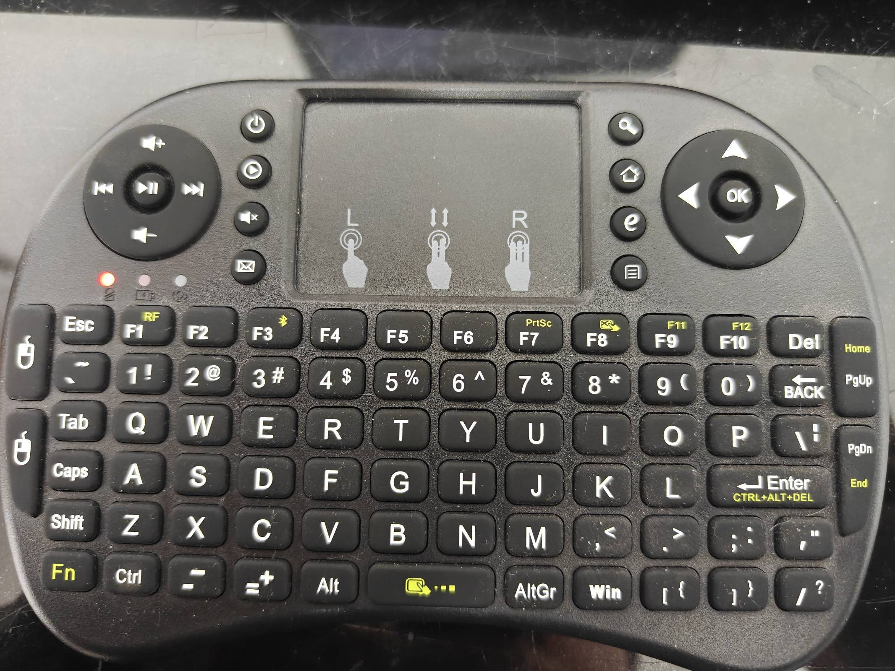
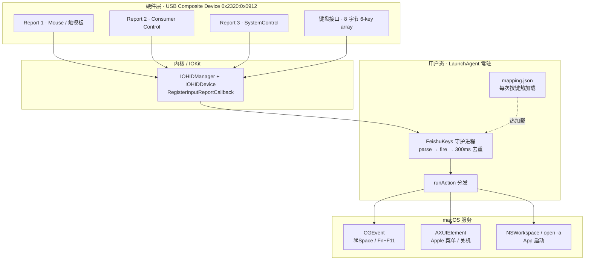

# 飞鼠按键 macOS 全适配（FeishuKeys）

把一台 USB「飞鼠」键盘/触摸板（`USB Composite Device`，VID `0x2320` / PID `0x0912`）上的**全部专用按键**在 macOS 上点亮：电源、菜单栏、启动台、邮件、Safari、Spotlight、显示桌面等。

实测环境：**macOS 12.7.6 Monterey (21H1320) / Macmini5,1 (Intel) / Xcode Command Line Tools `swiftc`**；对比方案 Karabiner-Elements 14.13.0。所有结论均来自本机真实按键日志与屏幕截图，不是推测。

## 硬件实物



上图为适配的实体设备（USB Composite Device，VID `0x2320` / PID `0x0912`）。本项目点亮的专用按键分布如下：

| 位置 | 按键 | HID Usage | 动作 |
|---|---|---|---|
| 左上竖排 1 | ⏻ 电源 | `0x01:0x0081` | 系统关机确认框 |
| 左上竖排 2 | ⏯ 播放/暂停 | `0x07:0x0065` | 打开启动台 launchpad|
| 左上竖排 3 | 原生静音 | `0x0C:0x018A` |  原生静音未作调整|
| 左上竖排 4 | ✉ 邮件 | `0x0C:0x0183` | 打开 Mail |
| 右上竖排 1 | 🔍 放大镜 | `0x0C:0x0221` | Spotlight |
| 右上竖排 2 | 🏠 房子 | `0x0C:0x0223` | 显示桌面 |
| 右上竖排 3 | `e` 浏览器 | `0x0C:0x0196` | 打开 Safari |
| 右上竖排 4 | ≡ 三条杠 | `0x07:0x0065` | 展开 Apple 菜单栏 |

完整码表见 [`docs/BUTTON-MAP.md`](docs/BUTTON-MAP.md)。

---

## 1. 成果总览：按键对照表

映射键格式 `UsagePage:Usage`。✅ = 已在 2026-11-15 17:27 与 17:34 两轮全键回归中由物理按键实测命中并执行成功。//注：AI自动生成顺序有误，具体顺序请以上面表格为准

| # | 物理按键 | HID Usage | 报告通道 | 动作 | 实现方式 | 实测 |
|---|---|---|---|---|---|---|
| 1 | ⏻ 电源 | `0x01:0x0081` | Report 3 (SystemControl) | `shutdown` | AXPress Apple 菜单 → 触发「关机…」→ 系统原生确认框 | ✅ |
| 2 | ≡ 三条杠 | `0x07:0x0065` | 键盘 8 字节报告 | `menubar` | `AXUIElement` 展开 Apple 菜单，焦点落在顶端菜单栏 | ✅ |
| 3 | 媒体 / ⏯ 播放键 | `0x0C:0x0183` | Report 2 (Consumer) | `launchpad` | `open -a Launchpad` | ✅ 用户最终手动实测成功 |
| 4 | ⏯ 播放/暂停（兼容码） | `0x0C:0x00CD` | Report 2 (Consumer) | `launchpad` | 同上，双码保险 | ✅ 校准期实测有上报 |
| 5 | ✉ 邮件 | `0x0C:0x018A` | Report 2 | `mail` | `open -a Mail` | ✅ |
| 6 | `e` / 浏览器 | `0x0C:0x0196` | Report 2 | `safari` | `open -a Safari` | ✅ |
| 7 | 🔍 放大镜 | `0x0C:0x0221` | Report 2 | `spotlight` | CGEvent 注入 `⌘Space` | ✅ |
| 8 | 🏠 房子 | `0x0C:0x0223` | Report 2 | `desktop` | CGEvent 注入 `Fn+F11` | ✅ |
| 9 | 🔇 静音 | `0x0C:0x00E2` | Report 2 | *不映射* | 交给 macOS 原生媒体键处理 | ✅ 原生可用 |
| 10 | 触摸板左右键 / 滚轮 | Report 1 | Mouse | *不映射* | 交给 macOS 原生，守护进程只读不拦 | ✅ 原生可用 |

**备用兼容码**（同一功能的历史猜测码，日志中未触发，保留不影响功能）：`0x0C:0x0182`→mail、`0x0C:0x0185`→safari。

**主动关闭的码**（避免误动作）：

- `0x01:0x0082` / `0x01:0x0083`：⏻ 同一按键经 report3/element 三通道重复上报的 Sleep/Wake 位，全部映射会导致一次按键并发触发 3 次动作。
- `0x0C:0x0238` AC Pan：触摸板横滑的相对位移数据，不是按键，不排除会刷屏。
- 其余 `none` 条目见 [`config/mapping.json`](config/mapping.json)（共 26 条）。

**遗留项**：5 条早期猜测的 `music` 码（`0x0193 / 0x01B7 / 0x01B8 / 0x01B9 / 0x01C7`）从未被任何按键触发。用户明确表示播放键由系统自带启动 Apple Music，无需再映射，这 5 条属可安全删除的死配置。

> ⚠️ **关机键是真的关机**：按 ⏻ 会弹出系统原生「您确定要现在将电脑关机吗？」对话框，**约 59 秒无操作会自动关机**。验证时请按 `Esc` 取消。

---

## 2. 架构：为什么必须直读 HID



**关键决策：放弃 Karabiner / `hidutil`，自己读原始报告。**

| 方案 | 失败原因 |
|---|---|
| Karabiner-Elements 14.13.0 Complex Modifications | 只接受官方登记的 113 个 `consumer_key_code` 名称；飞鼠的 `AC_Search(0x0221)`、`0x0183` 等被判为 *Unknown Consumer Event* 直接丢弃；填整数 Usage 也会被拒载 |
| `hidutil property --set '{"UserKeyMapping":...}'` | 只作用于 Keyboard Page `0x07`；对 Consumer Page `0x0C` 与 SystemControl `0x01/0x81` 写入能读回、但完全没有事件产生 |
| AppleScript + System Events 弹窗 | 重启后 AppleEvents 报 `-10004 权限违例` / `-1712 AppleEvent 已超时`，弹窗根本不出现 |
| 系统快捷键 `^F2` 聚焦菜单栏 | 全键盘访问 `AppleKeyboardUIMode` 命令行写入需注销重登才生效；`fnState=1` 与快捷键表 ID 7 的 Fn 位冲突；**物理键盘按 ^F2 同样无效**，确认是系统层问题 |

最终方案不依赖任何名称表、键映射表或快捷键表，且**不抓取（seize）设备**：macOS 原生的音量键、触摸板滚动、左右键全部照常工作，守护进程只做旁听 + 补发缺失的动作。

---

## 3. 数据流与实现要点

1. **设备枚举**：`IOHIDManagerSetDeviceMatching` 按 VID/PID 宽匹配拿到 2 个 HID 接口，逐个 `IOHIDDeviceOpen` + `RegisterInputReportCallback`；额外用 `UsagePairs` 精确匹配 `Consumer(0x0C/0x01)` 与 `SystemControl(0x01/0x80)` 再建两个 manager 兜底。
2. **双通道采集**：原始报告回调负责解析字节；`IOHIDValueCallback` 作为兜底。同一按键会经多路重复上报，用 `lastFire` 做 **300ms 去重**，避免一次按键执行多次动作。
3. **报告解析**：见 [`docs/HID-PROTOCOL.md`](docs/HID-PROTOCOL.md)。
4. **热加载映射**：`mapping.json` 在**每次按键时**读取，改配置不需要重编译、不需要重启、不需要重新授权。
5. **动作分发**：`runAction` 内置常用动作；`default` 分支支持 `~/.config/feishu-keys/actions/<动作>.sh` 外部脚本槽位，**以后新增动作也不用重编译**。
6. **开机自启**：`~/Library/LaunchAgents/com.dean.feishu-keys.plist`，`KeepAlive + RunAtLoad`，日志重定向到 `/tmp/feishu_keys_stdout.log`。

### 目录结构

```
feishu-keys/
├── README.md                    本文件
├── LICENSE                      MIT
├── docs/
│   ├── BUTTON-MAP.md            完整 26 条码表 + 实测日志证据
│   ├── HID-PROTOCOL.md          HID 报告格式、多点触控判据
│   ├── SYNC-TO-GITHUB.md        换电脑后拉取与同步说明
│   ├── TROUBLESHOOTING.md       排障记录、授权处理、还原命令
│   └── images/
│       └── feishu-keyboard-top.jpg  设备实物照片
├── src/
│   ├── FeishuKeys.swift         最终守护进程（419 行）
│   ├── HIDProbe.swift           原始报告探针
│   └── EventProbe.swift         按接口监听事件的探针
├── config/
│   └── mapping.json             最终映射表
└── tools/
    ├── setup_daemon.py          安装 / 卸载 / `--check` 一键自检
    └── parse_descriptor.py      HID 描述符解析（多点触控判据）
```

早期被弃用路线的产物（`build_config.py` Karabiner 规则生成器、`verify.py` 旧链路自检、`*.bak`）保留在本地，未纳入本仓库，原因见 `TROUBLESHOOTING.md`。

---

## 4. 快速开始

```bash
# 1) 编译（需要 Xcode Command Line Tools）
swiftc -O src/FeishuKeys.swift -o FeishuKeys

# 2) 安装映射表、LaunchAgent、Karabiner ignore，并自检
python3 tools/setup_daemon.py
python3 tools/setup_daemon.py --check
```

**首次必须完成两项系统授权**（系统设置 → 隐私与安全性）：

- 输入监控（Input Monitoring）→ 加入 `FeishuKeys` 二进制
- 辅助功能（Accessibility）→ 加入 `FeishuKeys` 二进制

授权前启动日志会出现 `manager open=-536870174`；授权成功后为 `manager open=0`，并出现两个 `report-callback=OK`。

> **重编译必读**：未签名二进制的 TCC 授权绑定 cdhash。**先**把系统级 TCC 两条授权的 `csreq` 置为 `NULL`（按路径匹配），**再**替换二进制，授权才不会失效。完整命令与顺序见 [`docs/TROUBLESHOOTING.md`](docs/TROUBLESHOOTING.md)。只改 `mapping.json` 不需要这一步。

**自检技巧**：无需按物理键也能端到端验证动作链路：

```bash
echo "launchpad" > /tmp/feishu_keys_trigger   # 守护进程轮询到即执行一次，随后删除该文件
tail -f /tmp/feishu_keys.log
```

---

## 5. 实测验证结果

`setup_daemon.py --check` 最终输出：

```
state = running / pid = 45573
kTCCServiceAccessibility -> 2
kTCCServiceListenEvent   -> 2
devices.ignore = True          # Karabiner 已释放飞鼠，不独占设备
映射表 26 条
```

17:34 全键回归日志摘录（每个键都由物理按键触发，非自检注入）：

```
17:34:29 EVENT 0x01:0x0081 src=report3 action=shutdown
17:34:42 EVENT 0x0C:0x0183 src=report2 action=launchpad
17:34:47 EVENT 0x0C:0x018A src=report2 action=mail
17:34:54 EVENT 0x0C:0x0221 src=report2 action=spotlight
17:34:56 EVENT 0x0C:0x0223 src=report2 action=desktop
17:34:59 EVENT 0x0C:0x0196 src=report2 action=safari
17:35:02 EVENT 0x07:0x0065 src=reportKB action=menubar
```

屏幕截图另行确认：`shutdown` 弹出系统原生关机确认框（已按 Esc 取消）、`menubar` 展开 Apple 菜单、`launchpad` 显示启动台全屏网格。

---

## 6. 已知限制与风险

| 项 | 说明 |
|---|---|
| 多点触控 | HID 描述符中**没有** `Digitizer Page 0x0D`、`TouchPad 0x05`、`ContactCount 0x54`、多个 `Finger 0x22` 集合，固件不上报触点数与每指坐标 → **硬件层无法实现真正的多指手势**，只能利用固件合成的 Wheel / AC Pan / Button 做伪手势。判据见 `HID-PROTOCOL.md` |
| `^F2` 物理快捷键 | 系统层失效，改动需注销重登。本项目用 `AXUIElement` 绕开，不依赖它；相关系统改动可逆，见 `TROUBLESHOOTING.md` |
| 启动台按键连按 | `open -a Launchpad` 是 **toggle**：连续按两次会「弹出 → 关闭」。单次按正常；想关启动台按 `Esc` 或点击空白处 |
| 系统改动 | `AppleKeyboardUIMode` 0→2（副作用：Tab 在所有控件间移动焦点）、快捷键表 ID 7 modifier 8650752→262144；均有备份与还原命令 |
| 合规 | 全程**未关闭 SIP、未加载内核扩展、未绕过 AMFI**。未签名二进制仅使用用户态 IOKit + Accessibility/Input Monitoring 授权；TCC 记录刷新属本机管理员维护操作，不是绕过系统安全机制 |
| 兼容性 | 在 macOS 12 Monterey / Intel Macmini5,1 实测。macOS 13+ 的 TCC 与 Launchpad 由 Dock 托管的行为可能变化，`AXUIElement` 与 `open -a Launchpad` 需回归验证 |

---

## 7. 完全还原

```bash
python3 tools/setup_daemon.py --reset                       # 停守护进程、删自启、恢复 Karabiner、清 hidutil
defaults write -g AppleKeyboardUIMode -int 0               # 还原全键盘访问
# 快捷键表用备份还原：/tmp/symbolichotkeys.bak.plist
```

---


---

本仓库记录的是一次完整的「硬件报文 → 用户态守护进程 → 系统服务」端到端适配，重点在于**用实测报文定位问题、用最小侵入方式补齐系统缺失的能力**。
