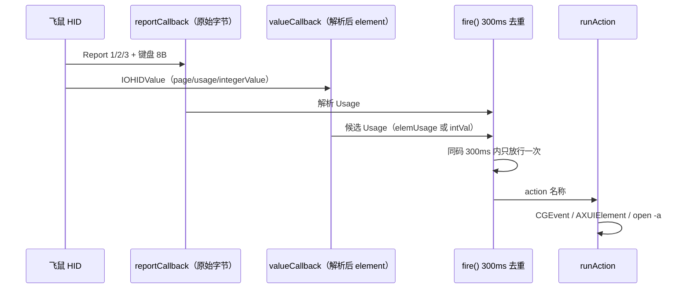

# HID 报告格式与硬件能力判据

设备：`USB Composite Device`，VID `0x2320`（8992）/ PID `0x0912`（2322），报告描述符 **119 字节**。内核枚举出 2 个 HID 接口：

| # | Primary Usage Page / Usage | 用途 |
|---|---|---|
| 0 | `0x01 / 0x0006` (Generic Desktop / Keyboard 复合) | 键盘 + 触摸板/鼠标 |
| 1 | Consumer / SystemControl 相关 | 多媒体与电源键 |

> 注：枚举时打印的 `page=0x01 usage=0x0006` 是复合设备的 Primary Usage，实际功能由下述 Report ID 与 Usage Page 区分。

## 1. 四种报告

### Report ID 1 — Mouse / 触摸板

```
[ID=01][buttons bitmask][X int8][Y int8][Wheel int8][AC_Pan 0x0238]
```

- `buttons`：`0x01` 左键、`0x02` 右键
- `Wheel`：纵向滚动相对位移
- `AC_Pan 0x0238`：横向滑动相对位移，**不是按键**；守护进程在 Consumer 分支显式排除，避免刷屏

守护进程对该报告**只读不拦**：记录有意义的 buttons / wheel / pan 变化，macOS 原生滚动与点击照常工作。

### Report ID 2 — Consumer Control

```
[ID=02][usage lo][usage hi]       16-bit little endian
```

例：`[02 83 01]` → `0x0183`；`[02 CD 00]` → `0x00CD`；松开一律为 `[02 00 00]` → `0x0000`。

飞鼠实测报出的 Consumer Usage：

| Usage | 含义 | 对应物理键 |
|---|---|---|
| `0x0183` | AL 区段（具体标准名未在 Karabiner 名称表登记） | 媒体 / ⏯ 启动台键 |
| `0x00CD` | Play / Pause | ⏯ 播放暂停 |
| `0x018A` | AL Email Reader | ✉ 邮件 |
| `0x0196` | AL Internet Browser | `e` / Safari |
| `0x0221` | AC Search | 🔍 放大镜 |
| `0x0223` | AC Home | 🏠 房子 |
| `0x00E2` | Mute | 🔇 静音 |
| `0x0238` | AC Pan | 触摸板横滑（非按键） |

### Report ID 3 — System Control

```
[ID=03][bits]      bit0=0x81 PowerDown, bit1=0x82 Sleep, bit2=0x83 WakeUp
```

⏻ 按下报 `[03 01]`，松开 `[03 00]`。固件把一次电源键同时置位/拆分上报，加上 element 兜底通道，一共会被看成 `0x81 / 0x82 / 0x83` 三条事件 —— 因此映射表只保留 `0x81`，另两条设为 `none`。

### 键盘接口 — 无 Report ID 的 8 字节报告

```
[modifier][reserved][key1][key2][key3][key4][key5][key6]
```

例：`[00 00 65 00 00 00 00 00]` → `keys=[0x65]` → `Keyboard / Application`（≡ 三条杠）。

**这是最容易漏掉的一路**：早期只监听 Report 1/2/3 时，≡ 键完全没有动作。守护进程在 `reportCallback` 的 `default` 分支处理 `rid == 0 && length >= 3` 的情况，把 `bytes[2..<8]` 的非零键码喂给 `fire(page: 0x07, ...)`。

## 2. 双通道采集与去重



`valueCallback` 的要点：

- Consumer / SystemControl 是 HID **Array**，element 的 `usage` 常为 0 或范围下界，真正的键码在 `integerValue` 里 → 两者都要检查。
- 必须排除鼠标轴 `page=0x01 && usage ∈ {0x30, 0x31, 0x38}`，否则 X/Y/Wheel 的相对位移数值会被误当成按键码触发动作。
- 键盘页要排除 `0x00..0x03`（ErrorRollOver 等哨兵）与 `0xE0..0xE7`（modifier 位图）。
- `CFNumber` 桥接必须用 `(v as? NSNumber)?.intValue`；早期写成 `v as? Int` 会静默失败，导致设备匹配全部落空。

## 3. 多点触控能力判据（结论：硬件层不支持）

用 `tools/parse_descriptor.py` 解析 119 字节报告描述符，检查是否具备真正多点触控所需的 HID 项：

| 必需的 HID 项 | 数值 | 本设备 |
|---|---|---|
| Digitizer Usage Page | `0x0D` | ❌ 不存在 |
| Touch Pad Usage | `0x05` | ❌ 不存在 |
| Contact Count | `0x54` | ❌ 不存在 |
| 多个 Finger Collection | `0x22` | ❌ 不存在 |
| 每指 X/Y 坐标 + Contact Identifier | — | ❌ 不存在 |

**结论**：固件不上报触点数量与每指坐标，只上报合成后的相对位移（X/Y/Wheel/AC Pan）与按键位图。因此**无法通过驱动或用户态程序还原出真正的双指/三指手势**——信息在硬件层就已丢失。

可行的替代只有「伪手势」：利用固件合成的 Wheel / AC Pan / Button 组合，在守护进程里按时间序列识别（例如快速横滑 + 左键 → 切换桌面）。本次未实现，因为用户最终目标是点亮专用按键，且伪手势容易与原生滚动冲突。

> 补充说明：实现真正的多点触控需要固件侧改报告描述符并上报 Digitizer 集合；这属于**固件改造**，不是 DriverKit / DEXT 能解决的。按 macOS 软硬件分层，本项目止步于用户态 IOKit 旁听，无需编写驱动、无需内核扩展。

## 4. 为什么名称表方案会失败

- Karabiner 的 `consumer_key_code` 只接受其登记的名称字符串；`0x0183`、`0x0221` 等被丢弃为 *Unknown Consumer Event*，直接写整数 Usage 会被配置校验拒载（`unknown consumer_key_code`）。
- `hidutil UserKeyMapping` 的匹配发生在 Keyboard Page 层，对 Consumer Page 与 SystemControl 不产生事件（写入后 `property --get` 能读回，但按键无任何反应）。
- 直读 `IOHIDDeviceRegisterInputReportCallback` 不经过任何名称表，任意 Usage 都能捕获 —— 这是本项目能点亮全部按键的根本原因。
